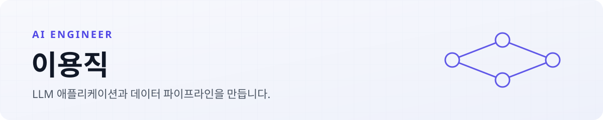

<picture>
  <source media="(prefers-color-scheme: dark)" srcset="assets/header-dark.svg">
  
</picture>

  
  

LLM 애플리케이션과 데이터 파이프라인을 주로 다룹니다.
노트북에서 끝나는 코드보다, 실행 조건과 테스트가 붙어 있는 코드를 만드는 데 관심이 있습니다.

**지금 하는 것**
- 팀 프로젝트에서 맡았던 부분을, 원본의 결함을 찾아 고치면서 재현 가능한 패키지로 다시 만들고 있습니다.
- 포트폴리오 사이트를 준비하고 있습니다.

---

### 👥 프로젝트

모두 팀 프로젝트입니다. `재구성` 표시는 팀 작업이 끝난 뒤 제가 노트북 코드를 다시 읽고, 결함을 고쳐 테스트를 갖춘 파이썬 패키지로 다시 만든 저장소입니다.

| 프로젝트 | 무엇을 | 제가 맡은 일 |
|---|---|---|
| **[khai-likelion-team-projects](https://github.com/iaynu/khai-likelion-team-projects)** lovelop · 멋쟁이사자처럼 | 소상공인 전략을 가상 상권에서 미리 실험합니다. 망원동 매장 721곳 위에서 생성형 에이전트 160명이 외식 의사결정을 하고, 전략 전/후를 11개 지표로 비교합니다 | 데이터 적재, 백엔드, 시뮬레이션 설계 및 실험, 페르소나 정의, 프론트엔드 개발 |
| **[lg-subscription-retention-agent](https://github.com/iaynu/lg-subscription-retention-agent)** LG전자 AX School · 6인 | 가전 구독 고객의 30일 내 해지를 예측하고(XGBoost), 이유를 10개 이탈 유형으로 설명하고(SHAP), 유형별 조치를 AI Agent가 제안합니다. 30,000건 규모 합성 데이터 기반 | 데이터 스키마 설계, AI Agent 파이프라인 설계 및 구현 |
| **[LearnCraft](https://github.com/iaynu/LearnCraft)** 멋쟁이사자처럼 KDT · 4인 | 강의 녹취록에서 RAG로 퀴즈·해설·오답노트·학습 플랜을 만듭니다. 단답형은 GPT 의미 채점, 코드 완성형은 Judge0로 실행 채점 | RAG 기반 학습 가이드 생성기, 오답 노트 기능(UI·API·메모·퀴즈 자동 저장, 데이터 소스를 DB로 통일), 학습·개인화 가이드 5개 섹션 형식 개편 |
| **[THJ-press-pump-anomaly-detection](https://github.com/iaynu/THJ-press-pump-anomaly-detection)** KAMP 제조데이터 경진대회 · 3인 | 진동·전류 시계열로 프레스 유압펌프 이상을 조기 탐지하고 오경보를 줄입니다. 정상 오경보율 1.3%, 실제 이상 21조각 재현율 100%, 주입 고장 11종 평균 재현율 71% | 팀원 각자 실험을 설계한 뒤, 각 방식의 장점을 결합해 최종 모델(2관점 MCD + 견고 보정 + 튐 복원)을 만들었습니다 |
| **[korean-medical-rag](https://github.com/iaynu/korean-medical-rag)** 멋쟁이사자처럼 · 5인 · `재구성` | 한국어 의료 QA 하이브리드 RAG. BM25와 벡터 검색을 융합하고 재랭킹한 뒤 LLM이 근거 문서로 답합니다 | 팀원 5인이 함께 설계·구현·실험. 이후 재구성하면서 조사 때문에 동작하지 않던 BM25 토크나이저(문자 n-gram), 순위를 버리던 후보 병합(RRF 융합), 문서 ID 충돌을 고쳤습니다. `테스트 231건` |
| **[stt-text-embedding-pipeline](https://github.com/iaynu/stt-text-embedding-pipeline)** 멋쟁이사자처럼 · 5인 · `재구성` | 119 신고 통화의 음성과 텍스트로 긴급도(하·중·상)를 분류하는 멀티모달 시스템의 텍스트 입력을 만듭니다 | 텍스트 임베딩 파트(STT 처리 기준 정의, KcELECTRA 임베딩 생성). 재구성하면서 3종 JSON 스키마를 구조 탐색으로 흡수하고, 저장 전 NaN·Inf·영벡터를 검출하게 했습니다. 20,041건 중 19,904건 처리. `테스트 76건` |
| **[LearnCraft](https://github.com/iaynu/LearnCraft)** 멋쟁이사자처럼 KDT · 4인 | 강의 녹취록에서 RAG로 퀴즈·해설·오답노트·학습 플랜을 만듭니다. 단답형은 GPT 의미 채점, 코드 완성형은 Judge0로 실행 채점 | 퀴즈 생성·채점 모듈(`src/quiz`) |

---

### 🧰 주로 쓰는 것

  
  
  
  
  

  
  
  
  
  

### 📜 자격증

정보처리기사 · SQLD · ADsP
